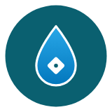
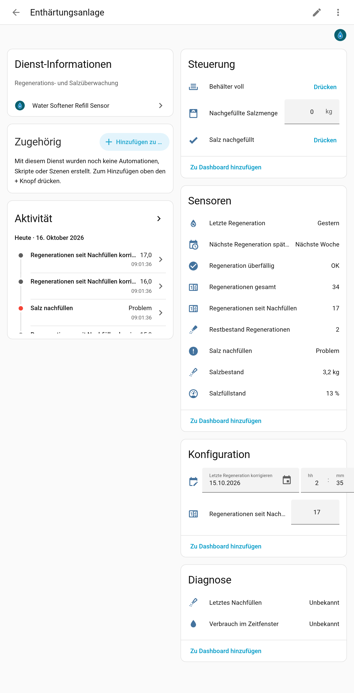

  

# Water Softener Refill Sensor

**English** | [Deutsch](https://github.com/BeGiBue/home-assistant-water-softener-refill-sensor#deutsch)

## English

Home Assistant integration that counts **how often a water softener has regenerated** and tracks the **salt stock**. It notifies you when salt needs to be refilled. It complements the [Boiler Room Scheme Card](https://github.com/BeGiBue/home-assistant-boiler-room-scheme-card) but also works without it.

The integration is shown in German when Home Assistant is set to German, and in English otherwise.

### How it works

- **Detecting a regeneration:** the softener regenerates at night (e.g. 2–3 am) and uses water. The integration watches the **water meter** (cumulative reading). If more than the **threshold** (default 45 litres) is used within the time window, that counts as **one** regeneration. Evaluation happens one minute after the window ends, so late meter updates still count. The window starts at the set local time and lasts the set hours in real time; on daylight saving nights it matches the softener's clock, which does not change by itself.
- **Calculating the salt stock:** you enter how many kilograms the brine tank holds and how much one regeneration uses. Each detected regeneration reduces the calculated stock.
- **Warning:** when the remaining stock reaches the warning level (default **3 regenerations**), a notification appears. It stays **until you confirm the refill with the amount in kg**: enter it under "Salt amount refilled" and press "Salt refilled", or call `water_softener_refill_sensor.refill` with `kg`. If the tank is completely full, the "Tank full" button is enough.

### Softener behaviour (Aqmos R2D2-32)

- Regenerates at night after its capacity is used, by default between 2 and 3 am. A regeneration usually uses **52–53 litres**; the default threshold of 45 litres detects it reliably.
- Also regenerates **at the latest 7 days after the last regeneration** (hygiene), even without water use. The integration shows "Next regeneration at the latest". If no regeneration is detected on that day (e.g. the water meter failed), "Regeneration overdue" appears; add it with `water_softener_refill_sensor.add_regeneration`.
- The tank nominally holds 25 kg of salt, of which only about 17 kg can actually be used. The default brine tank capacity is therefore 17 kg; one regeneration uses 1.28 kg. Partial refills are added to the stock; "Regenerations since refill" resets to 0 only when the tank is full.

### Setup

*Settings → Devices & services → Add integration → "Water Softener Refill Sensor".*

| Field | Meaning | Default |
|---|---|---|
| Name | Device name | Water softener |
| Water meter (total reading) | Sensor with the **cumulative reading** in a volume unit: L, mL, m³, gal, ft³, CCF (e.g. the Energy dashboard sensor) | – |
| Brine tank capacity | kg of salt the tank holds | 17 kg |
| Salt used per regeneration | kg of salt per regeneration | 1.28 kg |
| Current salt stock | Setup only, optional. Empty = tank full | – |
| Water use threshold | Use within the window above which a regeneration counts | 45 litres |
| Time window from / to | When regeneration happens (full hours, end after start) | 2 to 3 am |
| Warn at remaining stock of | Remaining regenerations at which the notification appears | 3 |

All values except name and initial stock can be changed later with **Configure**. **Starting mid-fill:** after setup, set "Correct last regeneration" and "Correct regenerations since refill" on the device.

### Entities

| Entity | Description |
|---|---|
| Regenerations total | All detected regenerations |
| Regenerations since refill | Since the last fill to full |
| Salt stock / Salt level | Calculated stock in kg / in percent |
| Remaining regenerations | How many regenerations the salt still lasts |
| Last regeneration | Time of the last detected or manually set regeneration (attribute `history`: last 10) |
| Next regeneration at the latest | 7 days after the last regeneration, start of the time window |
| Last refill / Water use in time window | Diagnostics |
| Refill salt / Regeneration overdue | Problem binary sensors |
| Salt amount refilled | Number input in kg; reset to 0 after confirming |
| Salt refilled / Tank full | Buttons to confirm a refill with the entered amount / set the stock to full |
| Correct last regeneration / Correct regenerations since refill | Inputs for manual corrections |

### Services

| Service | Purpose |
|---|---|
| `water_softener_refill_sensor.refill` | Confirm a refill; `kg` (required, > 0) is added to the stock (up to full) |
| `water_softener_refill_sensor.set_salt_stock` | Set the calculated stock in kg; "Regenerations since refill" is unchanged |
| `water_softener_refill_sensor.add_regeneration` | Add an undetected regeneration (`count`, optional `datetime`, not in the future) |
| `water_softener_refill_sensor.set_last_regeneration` | Set the time of the last regeneration; counters and stock unchanged |
| `water_softener_refill_sensor.set_regenerations_since_refill` | Set known regenerations since the last full fill; the stock changes relative to it |

With several softeners, also pass the entry (`config_entry`). Requires Home Assistant 2024.12 or newer.

Independent community project, not affiliated with Aqmos or Home Assistant. License: [AGPL-3.0-only](https://github.com/BeGiBue/home-assistant-water-softener-refill-sensor/blob/main/LICENSE).

## Deutsch

[English](https://github.com/BeGiBue/home-assistant-water-softener-refill-sensor#english) | **Deutsch**

Home-Assistant-Integration, die zählt, **wie oft eine Enthärtungsanlage regeneriert hat**, und den **Salzbestand** mitrechnet. Sie meldet sich, wenn Salz nachgefüllt werden muss. Sie ergänzt die Karte [Boiler Room Scheme Card](https://github.com/BeGiBue/home-assistant-boiler-room-scheme-card), funktioniert aber auch ohne sie.

Die Integration erscheint auf Deutsch, wenn Home Assistant auf Deutsch eingestellt ist, sonst auf Englisch.

### So funktioniert es

- **Regeneration erkennen:** Die Anlage regeneriert nachts (z. B. 2–3 Uhr) und verbraucht dabei Wasser. Die Integration überwacht den **Wasserzähler** (kumulierter Stand). Wird im Zeitfenster **mehr als der Schwellwert** (Standard 45 Liter) verbraucht, zählt das als **eine** Regeneration. Ausgewertet wird eine Minute nach Fensterende, verspätete Zählerwerte zählen noch mit. Das Fenster beginnt zur eingestellten Ortszeit und dauert die eingestellten Stunden in echter Zeit; in den Nächten der Zeitumstellung passt es zur Uhr der Anlage, die sich nicht selbst umstellt.
- **Salzbestand rechnen:** Du gibst ein, wie viel Kilogramm Salz in den Behälter passen und wie viel eine Regeneration verbraucht. Jede erkannte Regeneration verringert den rechnerischen Bestand.
- **Warnung:** Erreicht der Restbestand die Warnschwelle (Standard **3 Regenerationen**), erscheint eine Meldung. Sie bleibt, **bis du das Nachfüllen mit der Menge in kg bestätigst**: Menge bei „Nachgefüllte Salzmenge“ eingeben und „Salz nachgefüllt“ drücken, oder `water_softener_refill_sensor.refill` mit `kg` aufrufen. Ist der Behälter ganz voll, genügt die Taste „Behälter voll“.

### Verhalten der Anlage (Aqmos R2D2-32)

- Regeneriert nachts, nachdem ihre Kapazität verbraucht ist, standardmäßig zwischen 2 und 3 Uhr. Eine Regeneration verbraucht meist **52–53 Liter**; der Standard-Schwellwert von 45 Litern erfasst sie sicher.
- Regeneriert zusätzlich **spätestens 7 Tage nach der letzten Regeneration** (Hygiene), auch ohne Wasserverbrauch. Die Integration zeigt „Nächste Regeneration spätestens“. Wird an diesem Tag keine Regeneration erkannt (z. B. weil der Wasserzähler ausgefallen war), erscheint „Regeneration überfällig“; nachtragen mit `water_softener_refill_sensor.add_regeneration`.
- Der Behälter fasst nominell 25 kg Salz, davon sind nur ungefähr 17 kg tatsächlich nutzbar. Die Standard-Behältergröße ist deshalb 17 kg; eine Regeneration verbraucht 1,28 kg. Teilmengen werden zum Bestand addiert; „Regenerationen seit Nachfüllen“ springt erst auf 0, wenn der Behälter voll ist.

### Einrichtung

*Einstellungen → Geräte & Dienste → Integration hinzufügen → „Water Softener Refill Sensor“.*

| Feld | Bedeutung | Standard |
|---|---|---|
| Name | Name des Geräts | Enthärtungsanlage |
| Wasserzähler | Sensor mit dem **kumulierten Zählerstand** in einer Volumeneinheit: L, mL, m³, gal, ft³, CCF (z. B. der Sensor aus dem Energie-Dashboard) | – |
| Behältergröße | Wie viel kg Salz in den Behälter passen | 17 kg |
| Salzverbrauch pro Regeneration | kg Salz je Regeneration | 1,28 kg |
| Aktueller Salzbestand | Nur beim Einrichten, optional. Leer = Behälter voll | – |
| Schwellwert Wasserverbrauch | Verbrauch im Zeitfenster, ab dem eine Regeneration zählt | 45 Liter |
| Zeitfenster von / bis | Wann die Regeneration stattfindet (volle Stunden, Ende nach Beginn) | 2 bis 3 Uhr |
| Warnung bei Restbestand von | Restbestand in Regenerationen, ab dem die Meldung erscheint | 3 |

Alle Werte außer Name und Anfangsbestand lassen sich später über **Konfigurieren** ändern. **Mitten in einer Füllung starten:** nach der Einrichtung am Gerät „Letzte Regeneration korrigieren“ und „Regenerationen seit Nachfüllen korrigieren“ eintragen.

### Entitäten

| Entität | Beschreibung |
|---|---|
| Regenerationen gesamt | Alle erkannten Regenerationen |
| Regenerationen seit Nachfüllen | Seit dem letzten Füllen bis voll |
| Salzbestand / Salzfüllstand | Rechnerischer Bestand in kg / in Prozent |
| Restbestand Regenerationen | Für wie viele Regenerationen das Salz noch reicht |
| Letzte Regeneration | Zeitpunkt der letzten erkannten oder von Hand gesetzten Regeneration (Attribut `history`: letzte 10) |
| Nächste Regeneration spätestens | 7 Tage nach der letzten Regeneration, Beginn des Zeitfensters |
| Letztes Nachfüllen / Verbrauch im Zeitfenster | Diagnose |
| Salz nachfüllen / Regeneration überfällig | Binärsensoren „Problem“ |
| Nachgefüllte Salzmenge | Eingabe in kg; wird nach dem Bestätigen auf 0 gesetzt |
| Salz nachgefüllt / Behälter voll | Tasten: Nachfüllen mit der eingegebenen Menge bestätigen / Bestand auf voll setzen |
| Letzte Regeneration korrigieren / Regenerationen seit Nachfüllen korrigieren | Eingaben für Korrekturen von Hand |

### Dienste

| Dienst | Zweck |
|---|---|
| `water_softener_refill_sensor.refill` | Nachfüllen bestätigen; `kg` (Pflicht, > 0) wird zum Bestand addiert (höchstens bis voll) |
| `water_softener_refill_sensor.set_salt_stock` | Rechnerischen Bestand in kg setzen; „Regenerationen seit Nachfüllen“ bleibt unverändert |
| `water_softener_refill_sensor.add_regeneration` | Nicht erkannte Regeneration nachtragen (`count`, optional `datetime`, nicht in der Zukunft) |
| `water_softener_refill_sensor.set_last_regeneration` | Zeitpunkt der letzten Regeneration setzen; Zähler und Bestand bleiben unverändert |
| `water_softener_refill_sensor.set_regenerations_since_refill` | Bekannte Regenerationen seit dem letzten Füllen setzen; der Bestand ändert sich relativ dazu |

Bei mehreren Anlagen zusätzlich den Eintrag (`config_entry`) angeben. Benötigt Home Assistant 2024.12 oder neuer.

Unabhängiges Community-Projekt, ohne Verbindung zu Aqmos oder Home Assistant. Lizenz: [AGPL-3.0-only](https://github.com/BeGiBue/home-assistant-water-softener-refill-sensor/blob/main/LICENSE).
